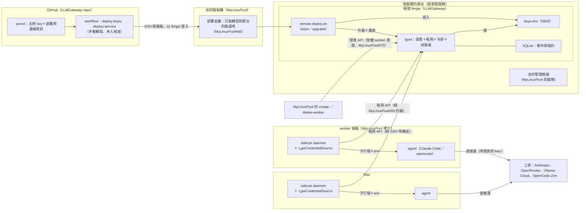
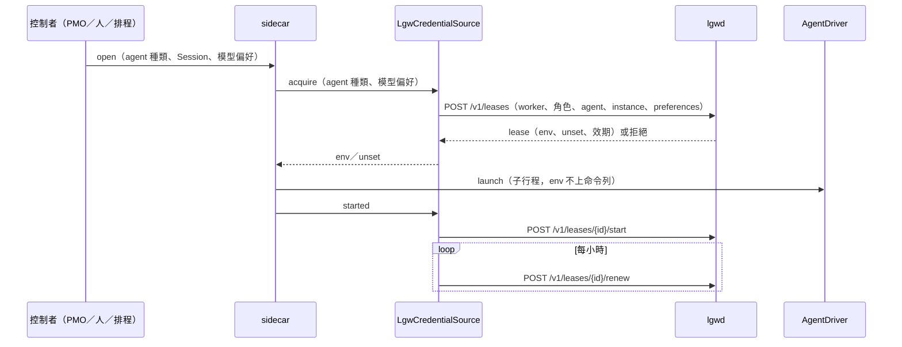
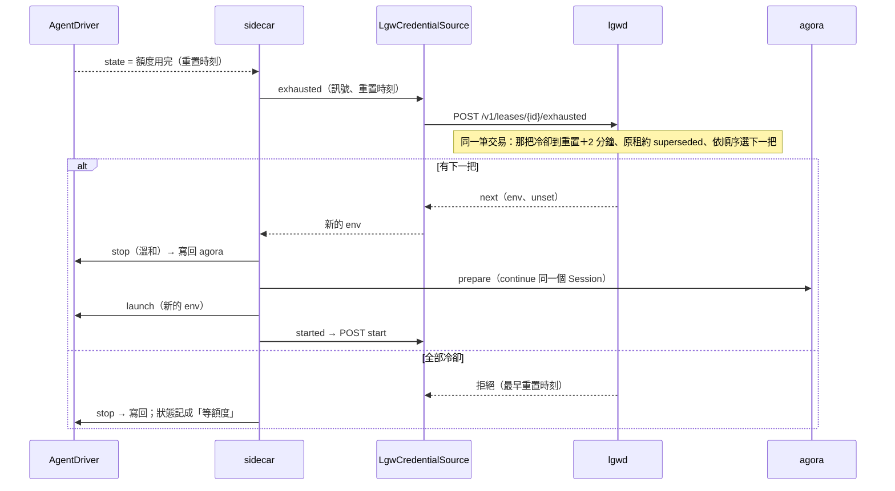
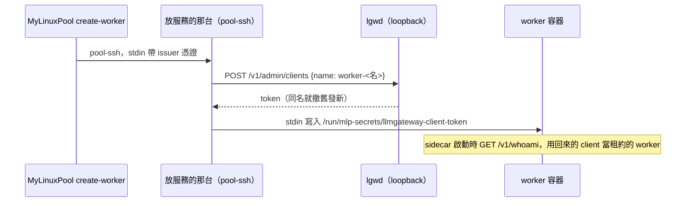
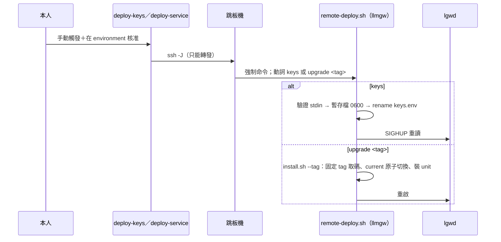
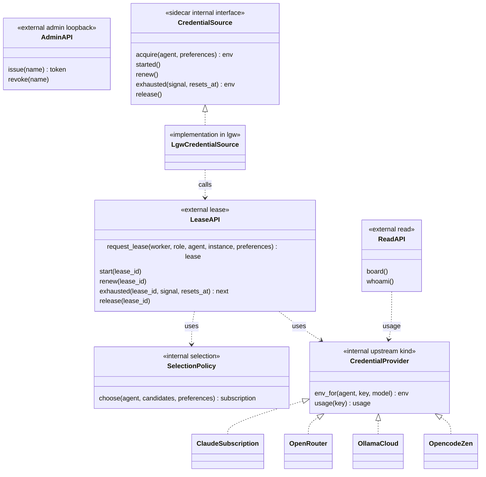

# LLMGateway v0：實體圖、控制時序圖、介面圖

> 依本人 2026-10-11 晚的回饋整理：介面簡潔、需要抽象時介面與實作分離、不要脆弱的相依、不基於 herdr、LLMGateway 跟 MyLinuxPool 無關。
> sidecar 那一側的完整設計在 MyAiStorage 的 `docs/proposals/aicompany-design-v2.md`（aistorage-pm），本檔只畫 LLMGateway 與它的接點，兩份用同一套名詞。
> 機器名不寫：「放服務的那台」是本人選定的常駐 provider。

## 1. 實體圖：有哪些東西、誰碰誰

| 誰 | 碰誰 | 怎麼碰 | 不做什麼 |
|---|---|---|---|
| deploy workflow | 那台的 `llmgw` | SSH 經跳板；`command=` 只能跑部署腳本的兩個動詞 | 不開 shell、不讀 key 以外的東西 |
| lgwd | key 檔、SQLite | 讀 key；記事件 | **不轉送模型請求**、不碰 sidecar、不碰 agent |
| sidecar | lgwd | 透過 `CredentialSource`（實作 `LgwCredentialSource`）呼叫租用 API | 不保存 key；sidecar 本體不知道 LLMGateway |
| agent | 上游 | 用 sidecar 給的 env 直接連 | 不經 LLMGateway；Claude 訂閱 token 只給原版 Claude Code |
| MyLinuxPool | lgwd | 管理 API（只綁 loopback、只限 `worker-*`） | 不碰 LLMGateway 的資料庫與 key |

## 2. 控制時序圖

### 2.1 開一個 agent（拿到一把 key）

### 2.2 額度用完、換一把（全部在 sidecar 內部；不是新的對外介面）

### 2.3 建 worker 時發憑證（MyLinuxPool#70）

### 2.4 部署 key 與升級

## 3. 介面圖（必要而且只有這些）

（類別圖裡的參數與回傳只寫主要的；完整欄位見 design 決定 6、表格見下。）

| 抽象 | 介面 | 這次的實作 | 換實作時不受影響的部分 |
|---|---|---|---|
| 租用（對外） | `LeaseAPI` 五個動作 | lgwd（HTTP＋SQLite） | sidecar、`LgwCredentialSource` 以外的所有人 |
| 發證（對外） | `AdminAPI` 兩個動作 | lgwd | MyLinuxPool 的 create-／delete-worker |
| 上游的種類 | `CredentialProvider` | Claude 訂閱、OpenRouter、Ollama Cloud、OpenCode Zen | 租用 API、選把規則、sidecar |
| 選把規則 | `SelectionPolicy` | 固定順序＋冷卻＋上限（之後：優先模型＋底線） | 租用 API、上游實作 |
| 拿 key 的方式（sidecar 側） | `CredentialSource` | `LgwCredentialSource`（本機開發可換成讀環境變數） | sidecar 本體、agent driver |
| 額度用完的判讀 | sidecar 的 `AgentDriver` 回報正規化狀態 | Claude Code、opencode 的 driver | sidecar 本體、LLMGateway |

**和前一版相比拿掉的**：
- `usage` 回報端點：v0 沒有人用；
- `lgw` 裡的換把程序：改在 sidecar 內部；
- 一切經 herdr 的做法：改成子行程。

**加上的**：
- `CredentialProvider`、`SelectionPolicy` 兩個內部介面：上游與選把規則都是實作。
